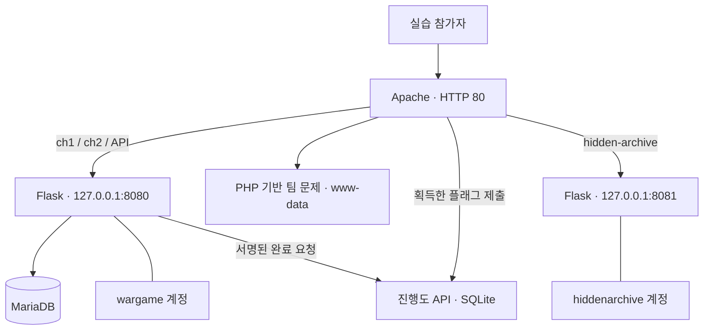

# 3줄 요약 좀 · Web Wargame

### 웹 취약점 문제 제작과 통합 실습 환경의 보안 설정

웹 취약점의 동작 원리를 직접 실습할 수 있도록 여러 문제를 하나의 가상머신으로 통합한 팀 프로젝트입니다. **문경구는 팀장으로서 Challenge 1·2를 담당하고, SSH·방화벽·sudo 및 파일 권한·서비스 계정 분리·문제 간 접근 통제를 구성했습니다.**

의도한 취약점은 문제 풀이를 위해 유지하면서, 취약점 실행이 다른 문제나 관리 영역으로 확산되지 않도록 통제하는 것을 목표로 했습니다. 이 저장소는 해당 기여를 설명하는 기술 문서와 제출용 OVA에서 확인한 구현·설정 근거를 제공합니다.

| 항목 | 내용 |
| --- | --- |
| 프로젝트 형태 | 팀 기반 웹 워게임 제작 및 통합 VM 배포 |
| 본인 | [문경구 · gyeonggumun](https://github.com/gyeonggumun) |
| 역할 | 팀장 / Challenge 1·2 담당 / 통합 환경 보안 설정 |
| 담당 문제 | JSON 기반 Blind SQL Injection, 웹훅 기반 OS Command Injection |
| 전체 구성 | Challenge 1~9, 총 10개 플래그 목표 |
| 대상 OS | Ubuntu 24.04.4 LTS |
| VM 사양 | 1 vCPU / RAM 2GB / 가상 디스크 10GiB |
| 주요 구성 | Apache, Flask, PyMySQL·MariaDB, PHP, systemd, UFW |
| 분석 범위 | OVA 정적 분석 + 38페이지 워크스루 대조 |

## 나의 기여

| 구분 | 수행 내용 | 확인할 근거 |
| --- | --- | --- |
| Challenge 1 제작 | JSON 로그인 API와 참·거짓 응답을 이용한 SQLi 실습 문제 | [문제 1 기술 설명](docs/CHALLENGE-01.md) |
| Challenge 2 제작 | 서버 측 웹훅 요청과 셸 해석을 이용한 명령 주입 실습 문제 | [문제 2 기술 설명](docs/CHALLENGE-02.md) |
| 보안 설정 | 서비스별 계정·파일 권한, 내부 포트, UFW, systemd 실행 제한, 로그인·sudo 권한 경계 구성 | [보안 설계와 검증](docs/SECURITY-DESIGN.md) |
| 팀장 역할 | 담당 문제와 팀 문제를 함께 운영할 수 있도록 접근 통제 기준을 적용 | [전체 환경 구조](docs/ARCHITECTURE.md) |

Challenge 3~9는 팀 전체 결과물을 설명하기 위한 배경입니다. 해당 문제의 개별 제작 성과를 본인의 기여로 표시하지 않습니다. 일정 관리·역할 배분·성과 수치처럼 제공 자료로 확인되지 않은 활동은 추가하지 않았습니다.

## 설계에서 중요하게 본 경계

외부 웹 진입점을 Apache로 모으고, Flask 서비스는 localhost에서만 수신하도록 구성했습니다. Flask 서비스는 서로 다른 OS 계정으로 실행하며, `NoNewPrivileges`와 `PrivateTmp`를 적용했습니다. 워게임 내부에서는 취약점이 의도대로 동작하되, 이를 운영 환경 전체의 권한으로 확대하지 않도록 경계를 두는 설계입니다.

다만 전용 계정과 디렉터리 권한이 모든 문제를 완전히 격리한다는 뜻은 아닙니다. Challenge 1·2는 같은 프로세스와 계정을 사용하고, PHP 문제들은 공통 웹 실행 계정의 영향을 받습니다. 제출본에서 확인한 남은 과제도 기술 문서에 함께 기록했습니다.

## 담당 문제 요약

### Challenge 1 · JSON Blind SQL Injection

`POST /api/ch1/login`에서 받은 `username`, `password`를 SQL 문자열에 직접 결합합니다. 응답에는 조회한 데이터가 포함되지 않지만, `success` / `fail` / `error`가 구분되어 참·거짓 조건을 확인할 수 있습니다.

워크스루에는 로그인 요청 분석, SQL 구문 변화 확인, Boolean 응답을 이용한 문자 추론, 플래그 획득 과정이 기록되어 있습니다. **오류 응답의 발생과 SQLi의 확정 근거를 구분하고**, 실제 취약한 쿼리 생성 코드를 함께 설명했습니다.

### Challenge 2 · Webhook Command Injection

`POST /api/ch2/webhook`이 입력 URL을 `curl` 명령 문자열에 삽입하고, `/bin/bash`의 `shell=True` 실행에 전달합니다. 일반 화면은 명령 출력을 직접 보여주지 않으므로, 워크스루에서는 실습자의 리스너로 돌아오는 요청을 관측해 실행 결과를 확인합니다.

**curl 사용 자체가 취약점의 원인은 아닙니다.** 사용자 입력이 셸 명령의 일부로 해석되는 구조가 핵심입니다. `curl`의 절대 경로, 실행 제한 시간과 PATH 제한은 셸 해석 문제를 제거하지 못한다는 점까지 다뤘습니다.

## 보안 설정의 확인 결과

| 영역 | 제출본에서 확인한 통제 | 해석 및 남은 과제 |
| --- | --- | --- |
| 외부 접근 | UFW 활성화 설정, 기본 수신·전달 DROP, HTTP 80 허용 | SSH 22는 IPv4·IPv6 모두 출발지 제한 없이 허용됨 |
| 서비스 계정 | `wargame`, `hiddenarchive` 분리 및 `nologin` | 서비스 계정의 대화형 로그인 제한을 확인 |
| 내부 서비스 | Flask 8080은 `127.0.0.1` 수신, Apache 프록시 | 내부 포트 은닉은 외부 진입점 축소이며 로컬 접근 차단과 다름 |
| 실행 권한 | `NoNewPrivileges=true`, `PrivateTmp=true` | 기존 계정이 읽을 수 있는 파일이나 외부 요청까지 차단하지는 않음 |
| 파일 경계 | 서비스별 디렉터리·소스 소유권과 제한된 모드 | `/etc/ch2_flag.txt`는 `0777`로 남아 있어 최소 권한 재정비 필요 |
| 진행도 | HMAC-SHA256 검증 및 플래그 확인 경로 | 공유 서명 키를 읽는 서비스가 침해될 때의 신뢰 경계 재검토 필요 |

SSH·방화벽 등 운영 설정을 맡았다는 본인 설명과, 제출본에서 직접 확인한 상태를 구분했습니다. **모든 비의도 접근을 차단했다는 결과를 주장하지 않습니다.**

## 기술 문서

- [전체 구조와 문제 구성](docs/ARCHITECTURE.md)
- [Challenge 1: SQLi 설계·동작·검증 근거](docs/CHALLENGE-01.md)
- [Challenge 2: 명령 주입과 관측 경로](docs/CHALLENGE-02.md)
- [보안 설정·권한 경계·개선 과제](docs/SECURITY-DESIGN.md)
- [분석 방법·출처·확인 범위](docs/VERIFICATION.md)
- [파일 해시·권한·설정 증거](docs/evidence.json)

## 공개 자료 안내

`reference/`에는 제출본의 서비스·네트워크 설정, 담당 문제의 템플릿, DB 비밀번호를 제거한 Flask 코드를 제공합니다. 원본 OVA·가상 디스크·PDF·실제 플래그·서명 키·참가자 데이터는 포함하지 않았습니다.

이 저장소는 **포트폴리오용 설계·분석 기록**이며 전체 워게임을 자동 설치하는 배포본은 아닙니다. 참고 구현에는 의도적인 취약점이 남아 있으므로 격리된 실습망에서만 사용합니다. OVA의 네트워크 설정은 브리지였으며, 이번 분석에서는 VM 부팅이나 공격 재실행 없이 가상 디스크와 기존 실습 기록을 대조했습니다.
