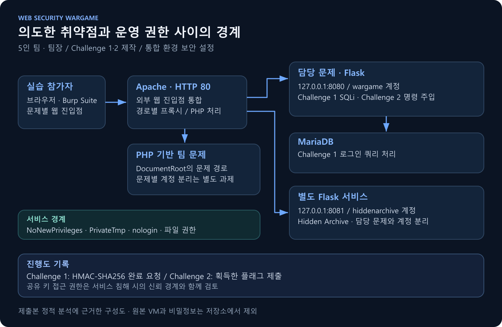
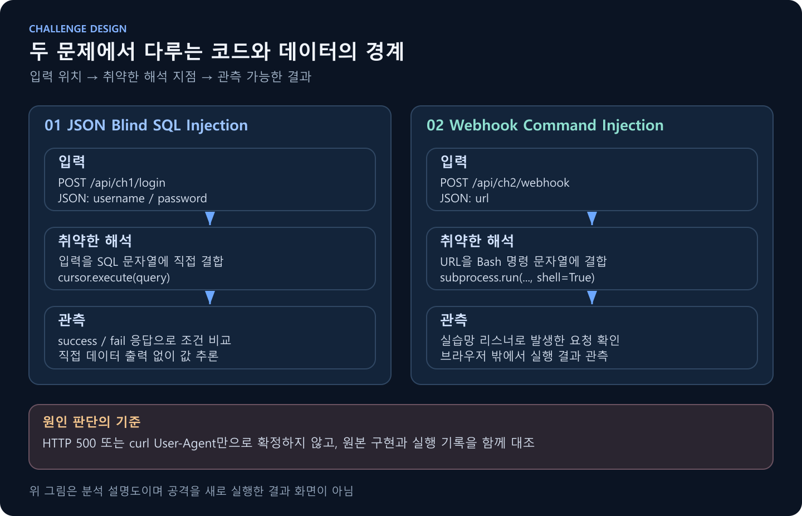
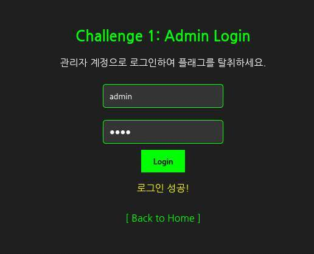

# 웹 취약점 워게임 플랫폼

### 웹 취약점 문제 제작과 통합 실습 환경의 보안 설정

웹 취약점의 동작 원리를 직접 실습할 수 있도록 여러 문제를 하나의 가상머신으로 통합한 팀 프로젝트입니다. **문경구는 팀장으로서 Challenge 1·2를 담당하고, SSH·방화벽·sudo 및 파일 권한·서비스 계정 분리·문제 간 접근 통제를 구성했습니다.**

의도한 취약점은 문제 풀이를 위해 유지하면서, 취약점 실행이 다른 문제나 관리 영역으로 확산되지 않도록 통제하는 것을 목표로 했습니다. 이 저장소는 해당 기여를 설명하는 기술 문서와 제출용 OVA에서 확인한 구현·설정 근거를 제공합니다.

| 항목 | 내용 |
| --- | --- |
| 프로젝트 형태 | 팀 기반 웹 워게임 제작 및 통합 VM 배포 |
| 팀 규모 | 5인 |
| 본인 | [문경구 · gyeonggumun](https://github.com/gyeonggumun) |
| 역할 | 팀장 / Challenge 1·2 담당 / 통합 환경 보안 설정 |
| 담당 문제 | JSON 기반 Blind SQL Injection, 웹훅 기반 OS Command Injection |
| 전체 구성 | Challenge 1~9, 총 10개 플래그 목표 |
| 대상 OS | Ubuntu 24.04.4 LTS |
| VM 사양 | 1 vCPU / RAM 2GB / 가상 디스크 10GiB |
| 주요 구성 | Apache, Flask, PyMySQL·MariaDB, PHP, systemd, UFW |
| 분석 범위 | OVA 정적 분석 + 38페이지 워크스루 대조 |

## 1. 문제 정의

웹 취약점을 개별적으로 설명하는 것만으로는 요청이 백엔드의 SQL·셸까지 전달되는 과정과 공격 결과를 판단하는 방법을 함께 학습하기 어렵습니다. 여러 문제를 하나의 VM에서 운영하면, 한 문제에서 얻은 실행 권한이 다른 문제의 파일·계정·완료 기록에 영향을 줄 수도 있습니다.

이를 해결하기 위해 **취약점의 원인을 관측할 수 있는 문제**와 **실습 기능 바깥의 접근을 줄이는 운영 경계**를 함께 구성했습니다.

| 기술적 과제 | 해결하고자 한 문제 | 설계 목표 |
| --- | --- | --- |
| 직접 출력이 없는 로그인 | 로그인 성공만으로는 SQL 내부 조건을 확인하기 어려움 | 참·거짓 응답을 이용해 Blind SQLi 원리 학습 |
| 서버 측 웹훅 실행 | 브라우저 응답만으로 명령 실행을 판단하기 어려움 | 실습망 리스너로 서버의 요청과 실행 결과 관측 |
| 통합 VM의 권한 공유 | 의도한 취약점이 다른 문제·관리 영역으로 확산될 가능성 | 서비스 계정·파일 권한·네트워크 진입점 분리 |

## 2. 나의 역할

**5인 팀의 팀장으로서 Challenge 1·2를 직접 제작하고, 통합 환경의 보안 설정을 담당했습니다.**

| 구분 | 수행 내용 | 확인할 근거 |
| --- | --- | --- |
| Challenge 1 제작 | JSON 로그인 API와 참·거짓 응답을 이용한 SQLi 실습 문제 | [문제 1 기술 설명](docs/CHALLENGE-01.md) |
| Challenge 2 제작 | 서버 측 웹훅 요청과 셸 해석을 이용한 명령 주입 실습 문제 | [문제 2 기술 설명](docs/CHALLENGE-02.md) |
| 보안 설정 | 서비스별 계정·파일 권한, 내부 포트, UFW, systemd 실행 제한, 로그인·sudo 권한 경계 구성 | [보안 설계와 검증](docs/SECURITY-DESIGN.md) |
| 팀장 역할 | 담당 문제와 팀 문제를 함께 운영할 수 있도록 접근 통제 기준을 적용 | [전체 환경 구조](docs/ARCHITECTURE.md) |

Challenge 3~9는 팀 전체 결과물입니다. 본인 제작 범위는 1·2번 문제이며, 보안 설정은 통합 환경을 대상으로 진행했습니다.

## 3. 접근과 의사결정



### 운영 구조의 선택과 절충

아래 비교는 제출본에서 확인한 구현과 그 기술적 의미를 정리한 것입니다.

| 판단 항목 | 비교할 수 있는 방식 | 적용한 방식과 선택 이유 | 절충점 |
| --- | --- | --- | --- |
| 외부 웹 진입점 | 각 앱의 포트 직접 노출 / 리버스 프록시 | Apache에서 경로별로 분기하고 Flask는 localhost 수신: 외부 진입점 단순화 | 프록시가 내부 계정의 접근까지 막아 주지는 않음 |
| 실행 계정 | 공통 root 실행 / 서비스 전용 계정 | `wargame`, `hiddenarchive`를 분리: 한 서비스의 권한 범위 축소 | 담당 문제 1·2는 같은 계정으로 남음 |
| 실행 제한 | 기본 서비스 실행 / systemd 제한 / 별도 컨테이너 | 전용 계정과 `NoNewPrivileges`, `PrivateTmp` 조합: 단일 VM 안에서 실행 경계 구성 | 문제별 컨테이너 수준의 파일시스템·네트워크 격리는 미적용 |
| 1번 문제의 관측 | 조회 데이터 직접 출력 / 조건별 응답 | `success`·`fail`을 이용: 데이터가 보이지 않아도 조건 추론을 학습 | 500 오류만으로 SQLi를 확정할 수 없음 |
| 2번 문제의 관측 | stdout 직접 표시 / 외부 요청 관측 | 일반 화면에 stdout을 표시하지 않고 실습망 요청을 관측 | 리스너 접근을 유지하면서 비의도 목적지 통제를 따로 설계해야 함 |

외부 웹 진입점을 Apache로 모으고, Flask 서비스는 localhost에서만 수신하도록 구성했습니다. Flask 서비스는 서로 다른 OS 계정으로 실행하며, `NoNewPrivileges`와 `PrivateTmp`를 적용했습니다. 워게임 내부에서는 취약점이 의도대로 동작하되, 이를 운영 환경 전체의 권한으로 확대하지 않도록 경계를 두는 설계입니다.

다만 전용 계정과 디렉터리 권한이 모든 문제를 완전히 격리한다는 뜻은 아닙니다. Challenge 1·2는 같은 프로세스와 계정을 사용하고, PHP 문제들은 공통 웹 실행 계정의 영향을 받습니다. 제출본에서 확인한 남은 과제도 기술 문서에 함께 기록했습니다.

### 담당 문제의 기술적 접근



#### Challenge 1 · JSON Blind SQL Injection

`POST /api/ch1/login`에서 받은 `username`, `password`를 SQL 문자열에 직접 결합합니다. 응답에는 조회한 데이터가 포함되지 않지만, `success` / `fail` / `error`가 구분되어 참·거짓 조건을 확인할 수 있습니다.

로그인 요청 분석 → SQL 구문 변화 확인 → Boolean 응답 비교 → 문자 추론으로 이어지도록 구성했습니다. 취약점의 원인은 입력이 완성된 SQL 문자열에 결합되는 구조입니다.

```python
query = (
    "SELECT * FROM users "
    f"WHERE username = '{username}' "
    f"AND password = '{password}'"
)
cursor.execute(query)
```

데이터를 조회하더라도 API는 행의 내용을 반환하지 않습니다. 따라서 성공·실패 응답을 기준으로 조건을 판별하는 구조가 문제의 핵심입니다. 실제 서비스에서는 입력값을 SQL 매개변수로 전달하고 비밀번호 해시를 검증하는 방식으로 수정해야 합니다.

<p align="center">
  
</p>

*기존 워크스루에서 추출한 로그인 화면입니다. 플래그 값과 내부 IP가 없는 이미지만 사용했습니다. 현재 VM을 새로 실행한 화면은 아닙니다.*

#### Challenge 2 · Webhook Command Injection

`POST /api/ch2/webhook`이 입력 URL을 `curl` 명령 문자열에 삽입하고, `/bin/bash`의 `shell=True` 실행에 전달합니다. 일반 화면은 명령 출력을 직접 보여주지 않으므로, 워크스루에서는 실습자의 리스너로 돌아오는 요청을 관측해 실행 결과를 확인합니다.

취약점의 원인은 입력 URL을 명령 문자열에 합친 뒤 `shell=True`로 실행하는 구조입니다. `curl`의 절대 경로와 제한 시간을 지정해도 입력의 셸 해석은 남습니다.

```python
command = (
    "/usr/bin/curl -v "
    "--connect-timeout 3 --max-time 10 "
    f"-X GET {webhook_url}"
)
result = subprocess.run(
    command, shell=True, executable="/bin/bash",
    capture_output=True, text=True, timeout=12,
)
```

워크스루에는 리스너 수신 기록과 목표 파일의 내용 확인 과정이 남아 있습니다. 실제 서비스에서는 셸을 거치지 않는 HTTP 클라이언트로 전환하고, 요청 대상·리다이렉션·내부 주소 접근을 별도로 제한해야 합니다.

### 운영 보안 설정의 적용 범위

| 영역 | 제출본에서 확인한 통제 | 해석 및 남은 과제 |
| --- | --- | --- |
| 외부 접근 | UFW 활성화 설정, 기본 수신·전달 DROP, HTTP 80 허용 | SSH 22는 IPv4·IPv6 모두 출발지 제한 없이 허용됨 |
| 서비스 계정 | `wargame`, `hiddenarchive` 분리 및 `nologin` | 서비스 계정의 대화형 로그인 제한을 확인 |
| 내부 서비스 | Flask 8080은 `127.0.0.1` 수신, Apache 프록시 | 내부 포트 은닉은 외부 진입점 축소이며 로컬 접근 차단과 다름 |
| 실행 권한 | `NoNewPrivileges=true`, `PrivateTmp=true` | 기존 계정이 읽을 수 있는 파일이나 외부 요청까지 차단하지는 않음 |
| 파일 경계 | 서비스별 디렉터리·소스 소유권과 제한된 모드 | `/etc/ch2_flag.txt`는 `0777`로 남아 있어 최소 권한 재정비 필요 |
| 진행도 | HMAC-SHA256 검증 및 플래그 확인 경로 | 공유 서명 키를 읽는 서비스가 침해될 때의 신뢰 경계 재검토 필요 |

운영 설정의 목표는 의도하지 않은 접근을 줄이는 것이었습니다. 제출본에서는 위 통제를 확인했으며, SSH 허용 범위와 과도한 파일 권한은 개선 과제로 남았습니다.

## 4. 결과

| 항목 | 확인한 결과 | 근거 |
| --- | --- | --- |
| 팀 전체 배포 구성 | 문제 **9개**, 플래그 목표 **10개**를 단일 OVA로 통합 | 워크스루와 중앙 완료 API |
| 직접 제작한 문제 | **2개**: SQLi 로그인 API와 웹훅 명령 주입 API | 원본 앱의 라우트·핸들러 |
| 담당 문제의 기존 풀이 기록 | **2개 모두** 워크스루에 플래그 획득 결과 존재 | PDF 3·6페이지, 이번 작업에서 재실행하지 않음 |
| Flask 서비스 운영 경계 | **2개** 전용 실행 계정, **2개** localhost 서비스 포트 | systemd, 계정 정보, 프록시·앱 설정 |
| 수신 허용 규칙 | IPv4·IPv6에 HTTP **80**, SSH **22** 허용 규칙 존재 | UFW 저장 규칙; 실제 열린 포트 전체를 측정한 값은 아님 |
| 배포 무결성 대조 | OVF·VMDK **2개 모두** 매니페스트 해시와 일치 | OVA 정적 분석 |

배포 사양은 **1 vCPU · RAM 2GB · 가상 디스크 10GiB**입니다. 응답 속도·배포 시간의 전후 비교는 측정하지 않았으므로 개선율로 제시하지 않았습니다. 세부 검증 범위는 [분석 기록](docs/VERIFICATION.md)에 정리했습니다.

## 5. 회고 및 배운 점

**취약점 제작과 운영 경계 설계는 함께 검토해야 합니다.** 1·2번 문제는 같은 계정으로 실행되므로, 명령 실행 권한을 얻으면 그 계정이 읽을 수 있는 소스와 DB 연결 정보까지 영향을 받을 수 있습니다. 다시 설계한다면 문제별 계정·DB 자격 증명 또는 컨테이너를 분리하겠습니다.

**보안 설정은 역할별로 확인해야 합니다.** localhost 바인딩은 외부 진입점을, `nologin`은 대화형 로그인을, `NoNewPrivileges`는 새로운 권한 획득을 제한합니다. 이 설정을 적용했더라도 파일 읽기·쓰기나 서비스 간 요청까지 자동으로 차단되지는 않습니다.

**통제의 성공과 남은 제약을 함께 기록해야 합니다.** 제출본의 `0777` 목표 파일, SSH 전체 출발지 허용, 공유 진행도 서명 키는 재정비할 부분입니다. 다음에는 ‘담당 문제 풀이 성공’과 ‘다른 문제의 파일·완료 기록 접근 실패’를 함께 확인하는 회귀 검증 기준을 만들겠습니다.

**공격 결과는 여러 근거로 판단해야 합니다.** HTTP 500이나 curl User-Agent 하나로 원인을 단정하기보다 요청·응답, 원본 코드, 기존 실행 결과를 연결해 SQL 해석과 셸 해석이 발생하는 지점을 설명하는 것이 중요했습니다.

## 기술 문서

- [전체 구조와 문제 구성](docs/ARCHITECTURE.md)
- [Challenge 1: SQLi 설계·동작·검증 근거](docs/CHALLENGE-01.md)
- [Challenge 2: 명령 주입과 관측 경로](docs/CHALLENGE-02.md)
- [보안 설정·권한 경계·개선 과제](docs/SECURITY-DESIGN.md)
- [분석 방법·출처·확인 범위](docs/VERIFICATION.md)
- [파일 해시·권한·설정 증거](docs/evidence.json)

## 공개 자료 안내

`reference/`에는 제출본의 서비스·네트워크 설정, 담당 문제의 템플릿, DB 비밀번호를 제거한 Flask 코드를 제공합니다. 원본 OVA·가상 디스크·PDF·실제 플래그·서명 키·참가자 데이터는 포함하지 않았습니다.

이 저장소는 **포트폴리오용 설계·분석 기록**이며 전체 워게임을 자동 설치하는 배포본은 아닙니다. 참고 구현에는 의도적인 취약점이 남아 있으므로 격리된 실습망에서만 사용합니다. OVA의 네트워크 설정은 브리지였으며, 이번 분석에서는 VM 부팅이나 공격 재실행 없이 가상 디스크와 기존 실습 기록을 대조했습니다.
