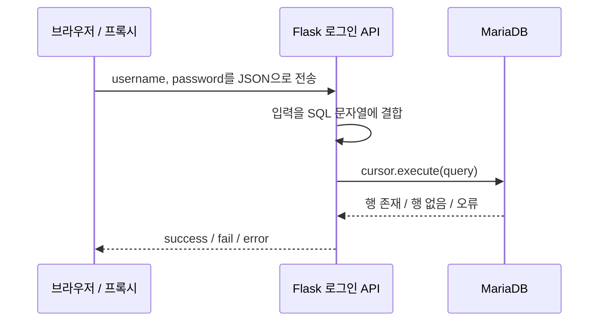

# Challenge 1 · JSON Blind SQL Injection

## 담당 범위와 학습 목표

본인이 담당한 첫 번째 문제입니다. 로그인 화면이 API와 통신하는 방식을 분석하고, 출력 데이터가 없는 상태에서도 응답의 참·거짓 차이로 DB 내부 조건을 추론하는 과정을 학습하도록 구성했습니다.

| 항목 | 내용 |
| --- | --- |
| 페이지 | `GET /ch1` |
| API | `POST /api/ch1/login` |
| 입력 | JSON의 `username`, `password` |
| 백엔드 | Flask / PyMySQL / MariaDB |
| 핵심 결함 | SQL 문자열에 사용자 입력 직접 결합 |
| 관측 신호 | JSON의 `success`, `fail`, `error`와 상태 코드 |

## 요청과 처리 구조



[비밀번호를 제거한 원본 앱](../reference/web/app.sanitized.py)의 `ch1_login()`은 다음 방식으로 쿼리를 생성합니다.

```python
query = (
    "SELECT * FROM users "
    f"WHERE username = '{username}' "
    f"AND password = '{password}'"
)
cursor.execute(query)
```

`execute()`를 사용했다는 사실만으로 매개변수 바인딩이 적용되는 것은 아닙니다. 여기서는 이미 합쳐진 SQL 문자열 한 개를 전달하므로 입력이 SQL 구문에 영향을 줍니다.

## 응답을 이용한 추론

| 처리 결과 | 앱의 응답 | 해석 |
| --- | --- | --- |
| 행이 조회됨 | `status: success` | 주입한 조건이 참인지 관측 가능 |
| 조회 행 없음 | `status: fail` | 참 조건과 비교할 거짓 응답 |
| 쿼리 실행 등 예외 | HTTP 500, `status: error` | 오류 상태이며 참·거짓과 구분 필요 |
| JSON을 얻지 못함 | HTTP 400 | 쿼리 실행 전 입력 처리 실패 |

워크스루에서는 일반 로그인 요청을 Burp Suite로 확인한 다음, SQL 조건을 바꿨을 때의 응답 차이를 비교합니다. 로그인 성공 화면에 플래그가 직접 출력되지 않으므로, 조건에 후보 문자를 넣고 성공 여부를 반복 확인해 값을 추론하는 흐름으로 이어집니다.

PDF 3페이지의 스크립트는 `LIKE BINARY`와 누적 접두사를 사용합니다. 이 방식의 `_`, `%`는 LIKE 와일드카드로 해석될 수 있으므로, 문자열 후보를 일반적인 완전 일치 검사로 설명해서는 안 됩니다. 대소문자 구분과 별개로 패턴 문자 처리를 고려해야 합니다.

## 검증 근거

| 확인 항목 | 근거 | 이번 분석의 확인 수준 |
| --- | --- | --- |
| JSON 요청과 엔드포인트 | 워크스루 1페이지, 원본 라우트 | 화면·소스 대조 |
| SQL 문자열 직접 결합 | `ch1_login()` | 정적 소스 확인 |
| 응답 분기 | `success` / `fail` / 예외 처리 | 정적 소스 확인 |
| Boolean 응답 기반 값 추론 | 워크스루 2~3페이지 | 기존 실습 기록 |
| 최종 플래그 출력 | 워크스루 3페이지 터미널 | 기존 실습 기록, 값 미공개 |
| 현재 DB의 실제 값·권한 | 실행 중 DB에 접속하지 않음 | 미검증 |

작은따옴표 입력에 HTTP 500이 나온다는 사실만으로 SQLi가 확정되는 것은 아닙니다. 이 프로젝트에서는 **문자열 결합 소스와 조건 변경 응답을 함께 확인**한 것이 판단 근거입니다. 워크스루의 추론 대상은 플래그 형태의 값이지만, 이번 분석에서 MariaDB의 현재 레코드를 직접 조회하지는 않았습니다.

## 운영 경계와 개선 방향

교육용 취약 쿼리는 문제의 핵심이므로 원본에 유지되어 있습니다. 실제 서비스에 적용하는 수정은 SQL 매개변수 바인딩, 적절한 비밀번호 해시 검증, DB 계정 최소 권한, 외부 응답과 내부 오류 로그의 분리입니다. 다음은 원본 구현이 아니라 대응 원리를 보여주는 예시입니다.

```python
cursor.execute(
    "SELECT username, password_hash FROM users WHERE username = %s",
    (username,),
)
# 조회한 해시는 애플리케이션의 비밀번호 검증 함수로 비교한다.
```

또한 로그인 성공 시 진행도를 기록하는 현재 구조에서는, 관리자 인증 우회와 플래그 전체 추론을 같은 완료 조건으로 둘 것인지 별도로 결정해야 합니다. 문자 추론을 필수 목표로 삼으려면 획득한 증거를 검증하는 완료 조건을 추가하는 것이 후속 과제입니다.
