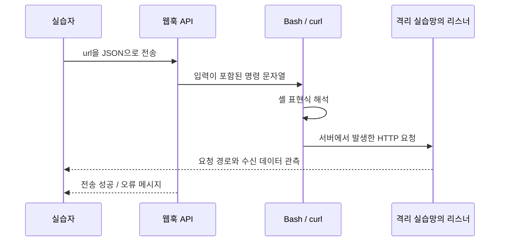

# Challenge 2 · Webhook Command Injection

## 담당 범위와 학습 목표

본인이 담당한 두 번째 문제입니다. 서버가 대신 요청을 보내는 웹훅 기능을 관측하고, 사용자 입력이 OS 명령으로 해석되는 지점을 이해하도록 구성했습니다. 브라우저에 일반 명령 출력이 보이지 않더라도 외부 리스너의 수신 기록으로 실행을 확인하는 과정이 핵심입니다.

| 항목 | 내용 |
| --- | --- |
| 페이지 | `GET /ch2` |
| API | `POST /api/ch2/webhook` |
| 입력 | JSON의 `url` |
| 실행 계정 | `wargame` |
| 핵심 결함 | URL을 명령 문자열에 삽입하고 Bash의 `shell=True`로 실행 |
| 목표 파일 | `/etc/ch2_flag.txt` |
| 완료 확인 | 별도 플래그 제출 API의 검증 |

## 취약한 실행 경계

[비밀번호를 제거한 원본 앱](../reference/web/app.sanitized.py)의 `ch2_webhook()`에서 확인한 구조입니다.

```python
command = (
    "/usr/bin/curl -v "
    "--connect-timeout 3 "
    "--max-time 10 "
    f"-X GET {webhook_url}"
)
result = subprocess.run(
    command,
    shell=True,
    executable="/bin/bash",
    capture_output=True,
    text=True,
    timeout=12,
)
```

문자열 입력 여부와 공백 제거·빈 값 검사는 있지만, 그 결과를 셸 명령과 분리하지 않습니다. 따라서 입력이 단순 URL 인자가 아니라 셸이 해석할 문자열의 일부가 됩니다.

`curl`을 `/usr/bin/curl`로 지정하고 PATH를 가상환경으로 제한해도 이 문제는 남습니다. 이는 PATH 하이재킹과 다른 결함이며, 실행 파일 경로를 고정하는 것만으로 셸 해석을 제거할 수는 없습니다.

## 외부 관측 흐름



워크스루 4페이지는 리스너가 수신한 요청과 `curl` User-Agent를 보여줍니다. 이것은 서버 측 HTTP 클라이언트의 동작을 관측하는 단서입니다. **User-Agent만으로 명령 주입을 확정할 수는 없으며**, 셸 해석 소스와 후속 실행 결과가 추가 근거입니다.

5~6페이지는 실행 결과를 요청 데이터에 실어 관측하고, Base64를 디코딩해 목표 파일의 내용을 확인하는 과정을 보여줍니다. Base64는 전송을 위한 인코딩이며 암호화나 접근 통제가 아닙니다. 원본 문서의 오탈자가 있는 명령은 검증된 실행 스크립트로 재배포하지 않았습니다.

## 응답과 제한 시간의 의미

| 구성 | 확인한 값 | 역할과 한계 |
| --- | --- | --- |
| curl 연결 제한 | 3초 | 연결 대기 제한 |
| curl 전체 제한 | 10초 | curl 실행 시간 제한 |
| Python subprocess 제한 | 12초 | 상위 호출의 대기 제한; 모든 자식 프로세스 정리를 증명하지 않음 |
| 정상 UI | JSON `message` 표시 | 일반적인 명령 stdout은 표시하지 않음 |
| 실패 API | 일부 분기에 stderr·예외 detail 포함 | API까지 출력이 전혀 없다고 설명하면 부정확 |
| 서비스 권한 | 비root `wargame` | root 실행 방지; 해당 계정의 파일·네트워크 권한은 사용 가능 |

따라서 이 문제는 외부 관측을 이용한 Blind 명령 주입 실습으로 설명하되, 모든 실패 경로까지 완전한 무출력이라고 단정하지 않습니다.

## 검증 근거와 남은 경계

API·명령 생성·`shell=True`·제한 시간은 원본 소스로 확인했습니다. 리스너 수신과 플래그 획득 결과는 워크스루 4~6페이지의 기존 실행 기록입니다. 이번 분석에서 VM을 부팅해 명령을 다시 실행하지 않았습니다.

제출본의 `/etc/ch2_flag.txt`는 root 소유, 그룹 `wargame`, 모드 **0777**입니다. 워게임 계정이 목표 파일을 읽어야 한다는 요구와, 모든 로컬 계정의 읽기·쓰기·실행을 허용하는 것은 다른 문제입니다. 읽기 전용 목표라면 root 소유·필요 그룹 읽기만 허용하는 방식으로 재정비해야 합니다.

## 대응 원리와 후속 과제

실제 서비스에서는 셸을 거치지 않는 HTTP 클라이언트를 사용하고, URL의 스킴·호스트·포트·리다이렉션·이름 해석 결과를 정책에 맞게 검증해야 합니다. 명령 주입을 제거해도 서버 측 요청 기능의 SSRF 위험이 자동으로 사라지는 것은 아닙니다.

교육 환경에서는 문제 풀이에 필요한 실습망 리스너 접근을 유지하면서, 다른 내부 서비스·관리 영역으로의 요청과 파일 접근을 별도로 제한하는 것이 목표입니다. 현재 UFW의 출력 기본 정책은 ACCEPT이므로, 외부 통신까지 허용 목록으로 통제했다고 주장하지 않습니다.
